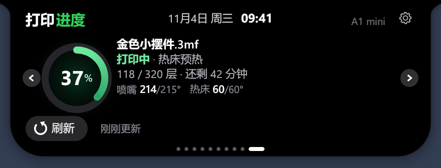
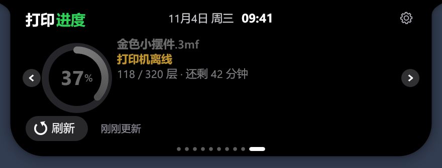
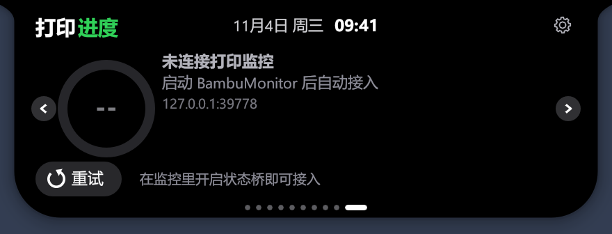

# 岛仔「打印进度」页 · 拓竹打印的实时进度

> 给 [岛仔 / xiaotang-daozai](https://github.com/Renly1994/xiaotang-daozai) 加的一个**可运行的参考实现**：新开一栏，显示本机拓竹打印机的实时百分比、层数、剩余时间、喷嘴/热床温度和告警。
>
> 出发点不是"把打印功能塞进本体"，而是给 [#138 插件提案](https://github.com/Renly1994/xiaotang-daozai/issues/138) 提供一个**真实的最小示例**，用来说明「显示个人关心的数据」这类插件到底需要宿主提供什么。



| 暂停 / 告警 | 打印机离线（保留上次画面） | 监控没开 |
|---|---|---|
|  |  |  |

---

## 为什么做成这个形状

先去读了一遍上游有没有留插件位：**没有**。

- 全仓库搜 `plugin / 插件 / 动态加载`：命中全在 `vendor/egui`、`vendor/eframe` 和第三方常量，没有注册表、没有动态库加载、没有事件总线。
- 唯一能跑用户代码的口子是 `src/relay_script.rs`（中转站额度自定义脚本，靠已依赖的 `rquickjs`），但它只产出 AI 额度面板的私有字段，画不了任意 UI。
- 上游 commit `e080728` 只加了 `.github/ISSUE_TEMPLATE/`：把「接入某个服务」「显示个人关心的数据（监控、倒计时、某个网站的数据等）」导向插件，并指向 issue #138。

所以这里按「将来能整块搬进插件」的形状做：**取数、渲染、设置全部收在一个模块里，中间隔一份 JSON 契约**。页面注册只有几行机械改动。

## 架构

```
打印机 ──(MQTT 局域网 / 云端)──> 拓竹打印监控 (Python, 本机)
                                    │  只读状态桥 GET 127.0.0.1:39778/status
                                    ▼
                             岛仔「打印进度」页 (Rust)
```

岛仔**不连接打印机、不保存打印机凭据**，只读本机回环地址上的 HTTP。桥只监听 `127.0.0.1`、只有 GET、没有写接口。

端口默认 39778，被占用时自动往后试，实际端口写在 `%APPDATA%\BambuMonitor\rt\bridge.json`，岛仔据此发现（读不到就用默认端口）。

### 数据契约

```json
{ "api": 1, "source": "bambumon", "updated": 1763300000.0, "age": 1.2,
  "printer": { "name": "A1 mini", "model": "A1 mini" },
  "status": { "online": true, "gcode_state": "RUNNING", "state_text": "打印中",
              "stage_text": "热床预热", "percent": 37, "remaining": 42,
              "layer": 118, "total_layer": 320, "file": "benchy.3mf",
              "nozzle": 214.5, "nozzle_target": 215, "bed": 59.8, "bed_target": 60,
              "hms": [], "ams_text": "空闲" } }
```

- `age` 由服务端算好（客户端不必对表，避免时钟偏差）
- `status` 就是监控界面在用的那份字段，原样透传；解析侧对「数字偶尔是字符串」做了宽松处理
- 另有 `GET /health` 用于探测

## 改动面

岛仔侧（对上游 v0.6.65 的完整 diff，`git apply --check` 通过）：

```
 src/app.rs      |  19 +-     页面注册（名称、设置分页、高度、标题、分发、轮询、箭头位置）
 src/bambu.rs    | 792 +++++  新增：数据契约 + 轮询 + 渲染 + 设置分页 + 测试
 src/extras.rs   |  13 +-     设置窗口新增「打印」分页
 src/lib.rs      |   1 +
 src/model.rs    |  19 +-     visible_pages / page_order 由 9 扩到 10，兼容旧配置
 src/ui_tests.rs | 116 +-     9→10 页的测试断言 + 打印页测试 + 预览导出
 919 insertions(+), 41 deletions(-)
```

监控侧：

```
 bambu_monitor/bridge.py           新增（约 200 行）
 bambu_monitor/ui.py               +18 行（建桥 / 每次重绘发布快照 / 关窗停桥）
 bambu_monitor/config.py           +4 行（app.bridge / app.bridge_port 默认值）
 tests/test_bridge.py              新增
 README.md                         +30 行（接口文档）
```

**纯增量**：没有改动任何既有功能的逻辑，页面可随时在「设置 → 页面管理」里关掉，关掉后不再轮询。

## 用起来

```bash
# 1) 监控侧（Python 3.10+）
pip install -r requirements.txt
python main.py            # 桥上就能读到状态了

# 2) 岛仔侧
git clone https://github.com/Renly1994/xiaotang-daozai.git
cd xiaotang-daozai && git apply /path/to/daozai-print-page.patch
cargo build --locked --release --bin daozai
```

开发时记得隔离数据目录：

```powershell
$env:DAOZAI_DATA_DIR = Join-Path $env:TEMP 'daozai-dev'
cargo test --locked --all-targets --features record -- --test-threads=1
```

## 验证过

1. 桥的单元测试：快照透传、`/health`、未知路径 404、端口冲突自动换端口
2. 真实链路：起真实监控进程，`curl 127.0.0.1:39778/status` 返回真实打印机数据
3. 岛仔取数：`cargo test reads_the_live_bridge` 读到同一份数据
4. 渲染：`bambu_gallery` 导出四种状态实拍图（走产品同一套 `App::frame()`）
5. 全量测试：`cargo test --locked --all-targets --features record -- --test-threads=1` → 1259 passed / 0 failed

## 顺带修的两个上游小问题

1. `state.py` 里 `Watcher.online` 从来没有被赋值为 `True`，所以 `summary()["online"]` 永远是 `False`（UI 判断连接用的是 `App._connected`）。桥改为用后者覆盖该字段。
2. Windows 上 `HTTPServer` 默认的 `allow_reuse_address` 对应 `SO_REUSEADDR`，语义与 Unix 不同——它允许**抢占**同一端口，于是"端口被占用"不会报错，两个进程会静默抢同一个端口。桥里关掉了，端口冲突才能正常退避。

## 想讨论的：如果要做插件，宿主需要给什么

这个用例能反推出「显示个人关心的数据」这一大类插件的最小能力集。详细讨论发在
[issue #138](https://github.com/Renly1994/xiaotang-daozai/issues/138)，这里放摘要。

**为什么额度槽位不够**：AI 额度 = 一个剩余量 + 重置时间，复用额度环刚好；打印 = 百分比 +
层数 + 两台温度 + 告警，塞进额度卡只能凑合；天气 = 温度 + 图标，又是另一套。要么开
「自定义页面槽位」，要么开「结构化数据槽位 + 通用卡片」。后者更容易保证观感一致，接口也更小。

**宿主最少给三样东西**：

1. **HTTP 拉取能力** —— 不要让插件自己起网络栈。注意：本体已读 `HTTPS_PROXY` 等环境变量，
   替插件连 `127.0.0.1` 时**必须显式绕过代理**，否则用户开了代理，本地请求也会被送进代理。
   本项目用的是单独 `try_proxy_from_env(false)` 的 agent。
2. **页面/卡片注册槽位** —— 要能声明标题两段文字、页面高度、hover/点击命中区域。
   高度这条容易漏：本体各页高度是 140 / 176 / 216 / 232，命中区域跟着高度算。
3. **主题与字体 API** —— 插件不该写死颜色字号，否则换皮肤就崩。本轮只用到
   `theme::*`、`size::TITLE/BODY/SMALL/TINY`、三档字重，和
   `c.text / fill / ring / seg / glow / capsule` 几个绘制原语。

示意 manifest（字段随作者定）：

```toml
id = "print-progress"
name = "打印进度"
api_version = 1
kind = "data-page"
poll = { interval_seconds = 1 }

[data]
url = "http://127.0.0.1:39778/status"
timeout_ms = 1500
bypass_proxy = true
```

插件只管"怎么取数 + 字段映射"，宿主管"什么时候轮询、怎么画、怎么跟着皮肤变"。

## 许可

岛仔本体是 MIT。这里的补丁与监控侧改动按同一许可提供，随便取用。

## 状态

这是我个人维护的 fork，跟着上游 v0.6.65。上游插件系统落地后，这个页面就该被改写成一个真插件——这份实现的价值是**接口形状的参考**，不是让人维护分支。
